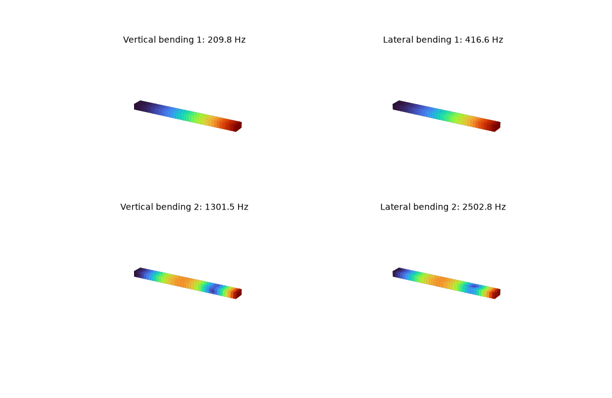
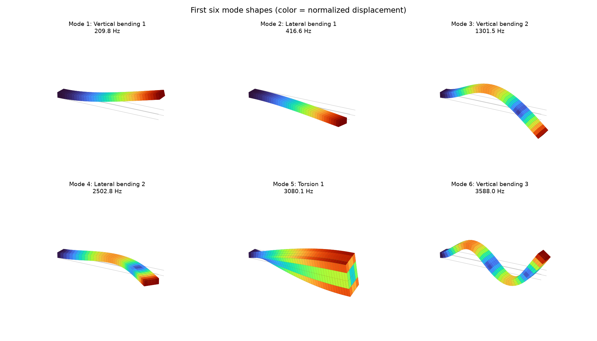
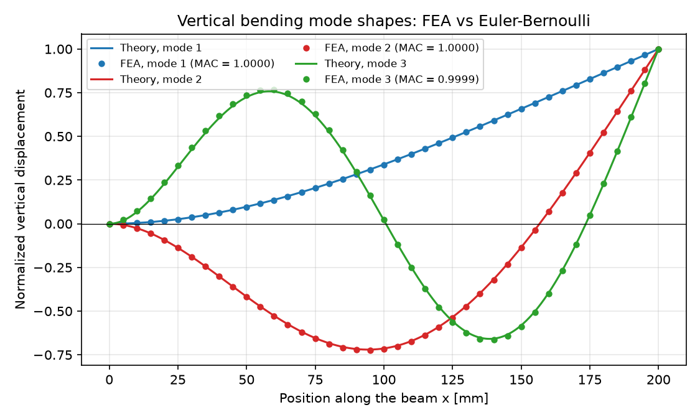
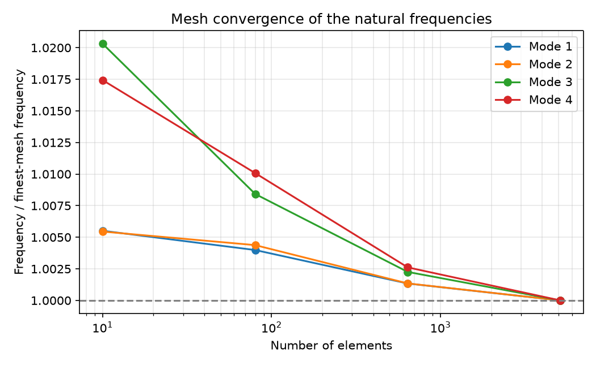
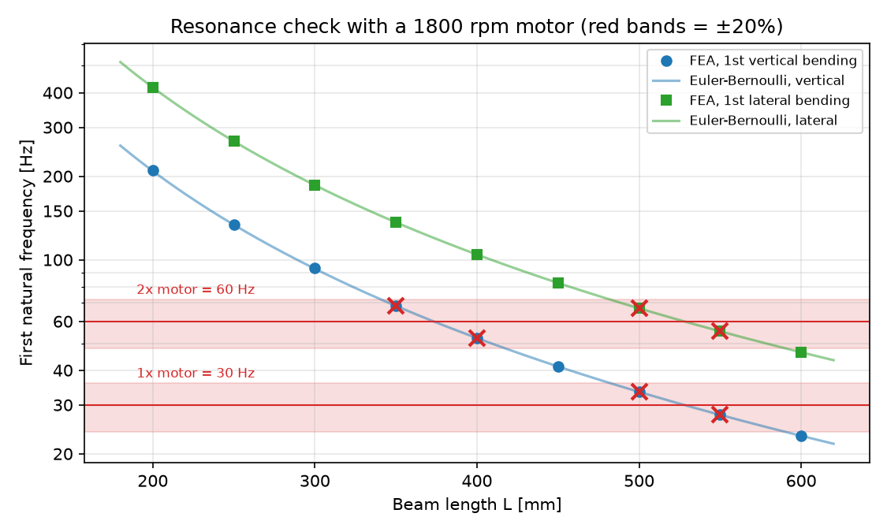

# Modal Analysis of a Cantilever Beam: Gmsh + CalculiX + Python

A fully scripted 3D modal analysis. One Python file builds the mesh, runs the eigenvalue solver, identifies every mode automatically, checks each frequency against analytical theory, studies mesh convergence and uses the results in a resonance design check. No GUI is used at any step.



## What the script does

1. **Meshing:** structured hexahedral mesh with the Gmsh Python API (C3D8I incompatible-mode elements, which avoid shear locking in bending).
2. **Solving:** writes a CalculiX input deck (`*FREQUENCY`, 10 modes) and runs the solver through `subprocess`.
3. **Post-processing:** reads the frequencies and effective modal masses from the `.dat` file and the mode shapes from the fixed-width `.frd` file.
4. **Mode identification:** each cross-section's motion is split into rigid parts (mean axial, lateral and vertical displacement and twist about the centroid). The part with the largest energy defines the mode type, so the script tells bending, torsion and axial modes apart with no manual input.
5. **Verification:** every mode is compared with the matching closed-form solution. Mode shapes are compared with Euler-Bernoulli using the Modal Assurance Criterion (MAC).
6. **Mesh convergence:** four meshes from 10 to 5,120 elements.
7. **Design study:** beam length vs. resonance with an 1800 rpm motor.

## Model

| Parameter | Value |
|---|---|
| Geometry | 200 x 20 x 10 mm steel bar (L x B x H) |
| Material | E = 210 GPa, ν = 0.3, ρ = 7850 kg/m³ |
| Boundary condition | All nodes at x = 0 fixed |
| Mesh | 40 x 4 x 4 C3D8I hexahedra (640 elements) |
| Units | mm, N, tonne, s (so frequencies come out directly in Hz) |

## Results

### Frequencies, mode types and theory



| Mode | Type (auto-detected) | FEA [Hz] | Theory [Hz] | Difference | Eff. mass X | Eff. mass Y | Eff. mass Z |
|---|---|---|---|---|---|---|---|
| 1 | Vertical bending 1 | 209.8 | 208.9 | +0.46% | 0% | 0% | 61.6% |
| 2 | Lateral bending 1 | 416.6 | 417.8 | -0.29% | 0% | 61.6% | 0% |
| 3 | Vertical bending 2 | 1301.5 | 1309.0 | -0.58% | 0% | 0% | 19.0% |
| 4 | Lateral bending 2 | 2502.8 | 2618.0 | -4.40% | 0% | 19.4% | 0% |
| 5 | Torsion 1 | 3080.1 | 2971.7 | +3.65% | 0% | 0% | 0% |
| 6 | Vertical bending 3 | 3588.0 | 3665.3 | -2.11% | 0% | 0% | 6.6% |
| 7 | Axial 1 | 6482.5 | 6465.2 | +0.27% | 81.4% | 0% | 0% |
| 8 | Lateral bending 3 | 6604.1 | 7330.6 | -9.91% | 0% | 6.8% | 0% |
| 9 | Vertical bending 4 | 6881.5 | 7182.5 | -4.19% | 0% | 0% | 3.4% |
| 10 | Torsion 2 | 9247.7 | 8915.2 | +3.73% | 0% | 0% | 0% |
| | **Cumulative** | | | | **81.4%** | **87.8%** | **90.6%** |

Theory used for each mode type:

- **Bending (Euler-Bernoulli):** f = (βₙL)² / (2πL²) · √(EI / ρA), with βₙL = 1.875, 4.694, 7.855, 10.996
- **Torsion (Saint-Venant):** f = (2n−1)/(4L) · √(GJ / ρIₚ), with J for a rectangular section
- **Axial:** f = (2n−1)/(4L) · √(E / ρ)

### Reading the differences

The FEA and the theory agree within 0.6% for the first three modes and for the axial mode. The larger differences are physics, not error, and each one has a clear cause:

- **Higher bending modes are lower in FEA.** Euler-Bernoulli ignores shear deformation and rotary inertia. As the mode number rises, the half-wavelength gets closer to the section size and those effects grow. The lateral modes deviate more because the beam is only 10 widths long (L/B = 10) against 20 heights (L/H = 20). This is exactly the case where Timoshenko beam theory would be needed.
- **Torsion is higher in FEA.** Saint-Venant torsion assumes the section warps freely. At the clamped end the 3D model stops the section from warping, which adds stiffness and raises the frequency.
- **Torsional modes have zero effective mass** in X, Y and Z because a pure twist about the centroid moves no net mass in any direction. This also confirms the auto-classification.
- **Mode 1 carries 61.6% of the vertical mass**, close to the classical 61.3% for a uniform cantilever. With 10 modes the captured mass is 81 to 91% per direction; a response spectrum or random vibration analysis would usually require 90% or more.

### Mode shapes vs. Euler-Bernoulli



The vertical displacement along the beam centerline matches the analytical mode shape with MAC = 1.0000, 0.9999 and 0.9999 for the first three bending modes. MAC = 1 means identical shapes.

### Mesh convergence



| Elements | Mode 1 | Mode 2 | Mode 3 | Mode 4 |
|---|---|---|---|---|
| 10 | 210.71 | 418.27 | 1324.93 | 2539.83 |
| 80 | 210.39 | 417.83 | 1309.49 | 2521.46 |
| 640 | 209.83 | 416.56 | 1301.48 | 2502.83 |
| 5120 | 209.55 | 416.01 | 1298.55 | 2496.30 |

Going from 640 to 5,120 elements changes the first four frequencies by 0.13 to 0.26%, so the 640-element baseline is mesh independent for engineering use. Frequencies fall as the mesh is refined, as expected for a displacement-based FE model, which is always slightly too stiff.

### Design study: avoiding resonance with a motor

A motor running at 1800 rpm excites the structure at 30 Hz (1x) and 60 Hz (2x). A common design rule is to keep every natural frequency at least 20% away from any excitation frequency. The script repeats the full FE analysis for lengths from 200 to 600 mm and checks both the first vertical and the first lateral bending modes.



| L [mm] | f vertical [Hz] | f lateral [Hz] | Verdict |
|---|---|---|---|
| 200 | 209.8 | 416.6 | OK |
| 250 | 134.2 | 267.1 | OK |
| 300 | 93.2 | 185.6 | OK |
| 350 | 68.4 | 136.4 | Resonance risk |
| 400 | 52.4 | 104.5 | Resonance risk |
| 450 | 41.4 | 82.6 | OK |
| 500 | 33.5 | 66.9 | Resonance risk |
| 550 | 27.7 | 55.3 | Resonance risk |
| 600 | 23.3 | 46.5 | OK |

**Takeaway:** a longer beam is not simply "worse". The safe lengths form windows (up to about 330 mm and around 450 mm) because the frequency curves cross the excitation bands. At 500 and 550 mm both modes are inside a band at the same time. Frequency scales with 1/L², so a small change in length moves a mode a long way, which is why this check belongs early in the design.

## How to run

Requirements: Python 3.10+, [CalculiX](http://www.calculix.de/) (the `ccx` solver; it ships with [PrePoMax](https://prepomax.fs.um.si/) on Windows).

```bash
pip install -r requirements.txt
```

Set the path to `ccx` at the top of `modal_analysis.py`:

```python
CCX = r"C:\path\to\ccx_dynamic.exe"   # Windows
CCX = "ccx"                            # Linux, if ccx is on PATH
```

Then run:

```bash
python modal_analysis.py
```

The full run (14 FE analyses, plots and GIF) takes under a minute. All figures and a text report are written to `results/`.

## Files

| File | Content |
|---|---|
| `modal_analysis.py` | The whole workflow |
| `results/report.txt` | Text report with every number in this README |
| `results/*.png`, `results/*.gif` | Figures |

## Possible extensions

- Timoshenko beam theory for the higher modes
- Harmonic response (`*STEADY STATE DYNAMICS`) with damping to get the actual amplification at resonance
- Prestressed modal analysis (stress stiffening)
- Shape optimization to push the first mode above a target frequency at minimum mass
